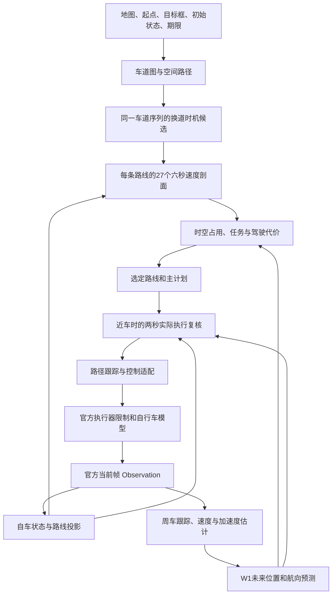

# r99：从结构化观测到控制的完整链条

本说明对应封存 r99 的实际入口 `CloseGuardPlanner`，不混入未启用实验。系统基于显式模型、有限候选搜索和逐帧反馈；在线没有神经网络、强化学习、LLM、MPC或LQR优化器。

## 1. 总体数据流

路线回答“沿哪里走”；轨迹回答“每个时刻在哪里”；控制动作回答“这一帧输出多少加速度、前轮角”。路线和速度共同确定占用时间，而控制器及官方模型决定实际占用。

## 2. 输入与感知边界

官方 `Observation` 提供自车 `x,y,v,a,yaw,rot,length,width`，周车类别、ID、`x,y,v,yaw,length,width`，以及 `t,dt,end` 和 `light_info`。坐标与尺寸单位米，速度米每秒，航向和前轮角弧度。官方状态更新保留三位小数。

周车类别为 vehicle、bicycle、pedestrian。系统用“类别/ID”维护身份，没有目标检测、数据关联、雷达点云、相机融合、SLAM或EKF定位。官方回放提供的是结构化状态，不等同于现实有噪声感知。类别被保留，但预测主要共用运动外推模型，没有行人专用行为预测。r99没有使用 `light_info` 实现信号灯通行策略。

背景对象按录制轨迹更新，不响应自车；自车由控制驱动。初始化只读取 xosc 的初始航向、速度和轨迹最大时间戳作为任务期限，没有把周车未来轨迹交给在线预测。场景名称不作为在线驾驶条件。

## 3. 初始化与任务表达

见 [onsite_replay.py](../stack/adapters/onsite_replay.py)。读取 startPos、targetPos、dt、xodr和xosc，解析车道中心线及前驱/后继，建立车道图。

地图 speed 标签支持 mph、km/h、m/s，取数值众数作为场景级速度参考，没有沿路逐段限速策略。缺失时 `v_des=max(60/3.6,v_initial)`。

任务目标是矩形。路线记录进入目标框和离开目标框的弧长 `goal_in/goal_out`。框内长度至少按0.5m计算，通过速度参考上限为 `max(3,(span-0.4)/dt)`，减少一步跨过目标框的问题；任务到达不要求停车。

初始化若均速要求高，会提高期望速度到最多1.45倍地图参考；每帧按剩余距离/剩余时间乘1.1重新提高期望速度，上限保持 `max(initial_desired,1.45*limit)`。限速是软设计，不能宣称严格遵守所有交通限速。

## 4. 车道图搜索

见 [route.py](../stack/core/route.py)。搜索状态为 `(lane_id,rev)`，中心线可以正向或反向使用，依赖几何门限和连接关系；这不是完整道路法规约束。

起点候选距中心线小于8m、局部方向差小于60°，随后只保留距离最邻近车道不超过0.8m的候选，减少从邻道错误起步。目标候选车道中心线距目标框中心小于3m。

拓扑连接要求端点距离小于4m、横向错位小于1.5m、方向差小于135°。邻道识别中心距1.5–5.5m，五个抽样至少三个符合，平行方向差门限30°，换道边方向差门限25°。

Dijkstra 前进边代价为下一段长度；横移边代价为 `12+0.1*目标段长度`。图搜索失败时降级为沿后继的贪心路线并记录 `issues`，有问题不等于所有基础运行都硬拒绝。

## 5. 空间路径与换道曲线

拼接中心线时补齐源/目标的并行走廊，扩展长度上限约400m。换道采用五次空间混合：

`w(u)=10u³−15u⁴+6u⁵`，`P=(1-w)P_source+wP_target`。

期望过渡长度 `max(25,4*v_ref)`，预留最短候选长度 `max(15,2*v_ref)`，按有效空间裁剪；有限空间时可缩到约8m。它按距离生成，实际换道时间随车速变化。连续横移为后续换道预留长度，并尽量在目标前5m完成。

装载检查起点偏差3m、起始方向60°、目标中心偏差2.5m、目标在前、路径穿框。动态变体拒绝带问题路线，基础降级不一定停止。没有全程车身位于合法车道内的证明。

## 6. Path几何与投影

见 [geometry.py](../stack/core/geometry.py)。路径约1m等弧长重采样；航向 unwrap 后插值，曲率由七点平滑航向对弧长求导并限幅±0.5。

`s` 是沿路径的距离，`e` 是横偏、左正右负。自车以历史 station 为提示在后15m/前60m范围投影，减少交叉路段跳变。周车批量全局投影用于跟车代价。

六秒主规划使用理想横偏 `e(t)=e0*exp(-t/1.5)`，未来航向等于路径方向，没有逐步运行真实横向控制器。这是重要近似。

## 7. W1运动状态估计

见 [world.py](../stack/core/world.py)。每个ID维护最新目标、vx/vy、yaw_rate、accel、位置和速度历史。

位置差分窗口约0.6s估速度向量；新目标用观测 `v*cos(yaw),v*sin(yaw)`。约0.8s速度历史估加速度，原始值限±3.5，低通为 `0.7*old+0.3*raw`。

由运动方向变化估转向率，原始值限±0.8rad/s，同样0.7/0.3低通。历史减小抖动也造成滞后，突然制动/转向未必即时反映。

当前帧消失的对象立即删除 Track 和历史预测评分，没有遮挡保持；`STALE_S`虽然定义但未参与删除逻辑。

## 8. W1未来运动预测

运动初始方向优先来自速度向量，低速使用观测yaw；速度大于2m/s才使用估计转率。

`h(t)=h0+2*omega*(1-exp(-t/2))`；默认 `v(t)=max(0,v0+a*t)`，制动到零不倒退。位置用右端点速度和方向离散积分。

正加速度可改为衰减趋势 `v(t)=max(0,v0+2*a*(1-exp(-t/2)))`。每帧保存两种模型的2s位置预测，等目标时刻实际观测到达后评分；保留近期2s误差，至少五条记录，衰减平均位置误差低超过0.25m且a>0，才切换。没有预读未来，也没有学习权重；制动保留原模型。

输出 `pos[A,K,2]`、`yaw[A,K]`、尺寸、速度向量、当前位置、ID。至少150m筛选范围按双方可达距离扩大，自车使用9.8加速度界、周车使用3.5加速度界并加入车身外接圆和1m余量；它是模型筛选界，不保证覆盖所有现实运动。

没有道路内约束、多意图概率、协方差或交互博弈。

## 9. 换道时机候选

见 [onsite_dynamic_route.py](../stack/adapters/onsite_dynamic_route.py)。固定同一lane_seq，只展开第一个未锁横移的起点比例 `0,.25,.5,.75,.95`；不是搜索所有车道序列。

剔除重复几何、issues、缺失过渡段和已错过的起点。初始化至少两条有效不同路线才启用动态机制，否则保留父路线。启用后即便最后剩一条仍保留可行性优先。

每帧共享一次world update和prediction，每条路线独立投影并评价27个纵向候选。路线排序为 `(预测碰撞,非按时到达,代价)`；晚换道附加 `1.5*fraction`。

接近选中换道起点前0.5m时锁定绝对起点，再生成下一个横移变体。锁定不是完整后续控制承诺，也不保证后续可行。

## 10. 六秒纵向候选

见 [arbiter.py](../stack/core/arbiter.py) 和 [native_profile.py](../stack/core/native_profile.py)。首段目标加速度 `-8,-6,-4,-3,-2,-1,0,.8,1.6,2.5`；第二段 `-3,0,1.5`，2s切换；删掉首段a<-2且次段a>0的组合，26种加一巡航，共27种。

巡航目标 `clip(.8*(v_des-v),-2,1.6)`。从当前真实a开始限变化，候选标签不是首帧立刻达到的加速度。

`s_next=s+v*dt+.5*a*dt²`，`v_next=max(0,v+a*dt)`。dt=.1为60步，dt=.04为150步，碰撞每.2s检查。

[CadencePlanner](../stack/adapters/onsite_cadence.py)按 `.1/dt` 缩放jerk以保留每帧增量：普通约.6、紧急约2m/s²；dt=.1对应6/20m/s³，dt=.04对应15/50m/s³。包络修正还会改变a，这不是全轨迹严格jerk证书。

## 11. 速度包络

前方250m每1m采样，参考上限为 `min(1.5*v_des,sqrt(2/max(abs(kappa),1e-4)),目标附近过框cap)`。按2m/s²减速从前方低上限向后回溯，形成提前减速包络。

推演速度超过包络时修正a，负修正最多-4；不会瞬间截断速度，不能声称所有点严格满足包络。期限会提高v_des，初始速度高或可用距离短时仍可能超出参考。

## 12. 主规划车身占用与碰撞

每车沿纵轴五圆，半径 `sqrt((L/10)²+(W/2)²)`。25对圆最小中心距减半径和作为余隙；长度超过五倍宽的长体用矩形SAT复核，缓解五圆侧向过度膨胀。

主层余隙缓冲 `.15+.06*t`，六秒达到.51m，每.2s离散检查，无连续扫掠证明。预计进入目标框后截断，保留一个检查间隔余量。

遗留缺口：当前五圆间隙<=0的对象被 `live=False` 屏蔽未来影响；两秒守卫绕过，但六秒层仍未彻底替换。

## 13. 仲裁代价与选择

碰撞权1000并按首次冲突时间加罚；不足1m余隙平方积分权4；跟车权2，需求净距`.8*v+2m`。当前lead选择ahead .5–150m、abs(e)<1.8+W/2、沿向速度>-1、横向速度<1.5。

跟车未来station用当前沿向匀速，没有完整采用W1的未来横移，因此前车离开路线时仍可能有保守罚项。

普通ETA为6s后剩距/v_des粗估；预算ETA从6s末位置与末速沿同包络模拟无交通续行，超预算权3。超期望速度平方积分权.5；前2s a²权.02、jerk²权.01；首a与上主计划差权.05。六秒外交通没有完整进入续行ETA。

`NativeArbiter`按有限碰撞罚总成本选择；动态机制使用`NativeFeasibleArbiter`先筛预测无碰候选，全碰时回退总成本。剩余期限<=6s时优先理想XY推演确实无碰按时进框的候选。

输出Plan包含首a、标签、成本、首次冲突、最小余隙、s/v/a序列、all_collide和on_time。all_collide只表示当前有限候选在当前预测下全碰，不证明物理无解。

## 14. 两秒实际执行守卫

见 [onsite_close_guard.py](../stack/adapters/onsite_close_guard.py)。任意周车当前五圆余隙<=15m触发；2s按真实dt检查20或50步。

19候选：原a序列×跟踪1个；恒定a=-9.8/0/2.5×track/hold/zero共9个；原计划执行.3/.6/1s后-9.8共3个；4.5或9.8加速.3/.6/1s后-9.8共6个。hold以当前实际rot为目标，zero以零为目标，仍经历变化率和低速控制。

[native_execution.py](../stack/core/native_execution.py)推演路径投影、真实tracker、控制器prev_steer、官方jerk49、角速度1.397、前轮角.699、Euler与三位舍入。

周车分支取W1、当前v/yaw匀速、同方向1.5m/s²加速的并集；最后一个仅对Track.accel>=0启用。检查全部保留对象的矩形SAT，不应用旧live屏蔽。

r99阈值为SAT间隙<=0命中，没有主层正缓冲，厘米级名义余隙也可通过；SAT正值是分离判据/余隙下界，不是精确欧氏距离。

原候选无碰立即保持。脉冲新启动要求原方案首冲突<=1s；已启动恢复候选族保留2s。每帧重新检查，不强制上一后缀，也没有递归可行性保证。

无碰候选还要求最大横偏<=max(abs(current_e)+.5,1.5)，按首转角差、首a差、负余隙排序。无合格候选回退原动作，不能叫保证安全的shield。主计划last在守卫前记录，守卫改动作不反馈为新主Plan。

## 15. 横向跟踪与控制

见 [control.py](../stack/core/control.py)。预瞄`s+max(v,1)*.25`；期望航向`h_path-atan(.9*e/(v+2))`；横摆角速度`v*kappa+2.2*wrap(desired-yaw)`。

前轮角`atan(yaw_rate*(length/1.7)/v)`，v<=.3时保留prev_steer。控制加速度夹±9.8、前轮角夹±.699、变化夹`1.397*dt*.98`。

输出 `[acc_mps2,front_wheel_angle_rad]`，不是油门百分比和方向盘角。纵向直接来自首a，没有独立PID速度控制。offset接口存在，r99普通调用offset=0。

## 16. 官方执行与反馈

官方check_action再次执行加速度±9.8、jerk±49、前轮±.699、变化率±1.397限制，停车时a=-v/dt避免倒退。

位置前向Euler `x+=v*cos(yaw)*dt,y+=v*sin(yaw)*dt`；`yaw+=v/length*1.7*tan(delta)*dt`；然后`v=max(0,v+a*dt)`，round3。主层纵向积分带.5*a*dt²，执行层没有，因此存在合同差异。

帧序：背景更新和终止判断 → act → check_action → 更新时间与自车 → 下一帧。只执行首动作，未来计划随实际观测变化。

官方出界按地图全局包围框，不是合法道路区域；t>.5s才进行矩形碰撞检查；到达按自车中心进目标框，无停车要求。同帧状态后写覆盖：到达优先于碰撞、超时、出界。

## 17. 代码组织与在线启用范围

继承链：`CloseGuardPlanner → CadencePlanner → DynamicRouteCapabilityPlanner → ArbiterPlanner`。

对应近车复核、周期/编译适配、换道时机、基础接入。主要仲裁加守卫二次选择构成实际决策，不能把基础注释“唯一决策点”套到最终版本。

归档里`CapabilityArbiter`的12额外救援纵向原语未在r99入口启用；`LateralCurve`时间偏移类也非主线。完整24个py保留是为了身份一致，存在文件不代表在线启用。

## 18. 性能与能力边界

NumPy批量计算、Numba编译profile/距离/包络/ETA/执行；圆距离先归约平方距离再开方；缓存路径和锁定前缀；初始化预热编译签名。有限模型、有限候选和近车触发是速度来源，也限制能力。

130场107/7/16、0异常，完整act平均5.8206ms、p95 9.2740ms、p99 14.9521ms，逐场130通过。保留r96全部104成功且无新增碰撞。它是可追溯开发底座，仍存在23场失败。

主要未完成问题是六秒理想层与两秒实际层的占用/缓冲不一致、预测意图不足、候选不完备、全碰回退、道路与信号规则缺口。计算快和更高到达率不能直接证明这些缺口已经消失。
