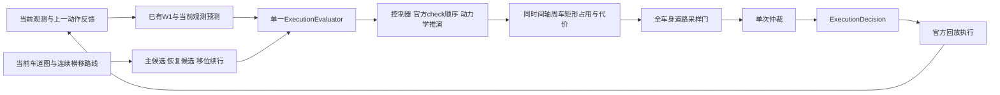

# r43候选的一帧执行链

入口 `candidates/r43/source/stack/adapters/onsite_unified.py:UnifiedPlanner`。根目录stack仍为r99，使用候选必须先独立导入候选source；避免将两版模块混在一个Python进程中。

候选自车每一步按真实控制器和官方停止修正/jerk/转角变化/幅值/旧速Euler/舍入推进，保存command、checked_action和expected_next_state；反馈逐值比较执行后的状态。停车速度为零时车身不会沿理想路线自行移动。主候选和恢复、续行共享推演与仲裁契约。

占用检查为采样SAT矩形，分别记录buffer不足与车身接触、首对象、分支和时刻。原W1预测保留；近两秒有额外分支，远六秒仍主要依赖W1，因此远期未来为未知能力缺口。所有交通输入来自当时可见观测；未来记录只用于事后诊断，不参与动作、候选或代价。

道路门检查完整车身落在给定地图的车道联合内，保留真实洞/缺口。共享边界必须有解析器身份、同向相邻与互认等证据才能共享。初始外伸允许不增长并恢复；首次回图后又外伸，不论是否小于原面积，都列新问题。缺地图不当作有可行道路。

实际入目标盒的推演见证优先于乐观ETA。当前前缀可行与六秒尾部、下一帧可恢复是不同强度的证据；“execution_prefix_checked_on_grid”只表示当前有限前缀。全无解时显式标risk_mitigation，不将其称安全。续行每帧递减并重新评估，后缀失败不能强持有。

compound_route针对相邻连续横移缺段/折返补完整几何；开始过渡后保存所选路线和图边承诺。它在冻结r26配对中只改变14_14，有完整230记录支持；并未修复全部预测、恢复和目标覆盖缺口。

可直接阅读： [onsite_unified.py](../candidates/r43/source/stack/adapters/onsite_unified.py)、[unified_evaluation.py](../candidates/r43/source/stack/core/unified_evaluation.py)、[compound_route.py](../candidates/r43/source/stack/core/compound_route.py)、[road_boundary.py](../candidates/r43/source/stack/core/road_boundary.py)。
